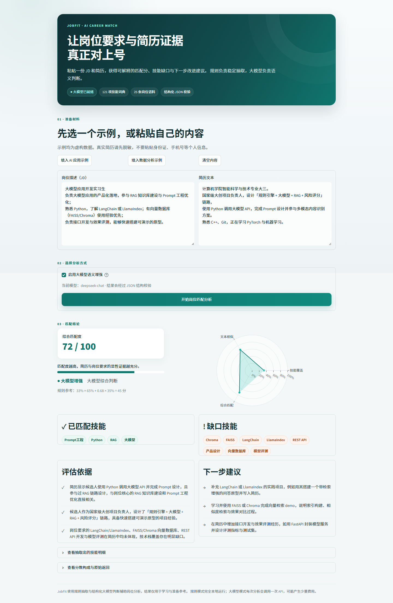
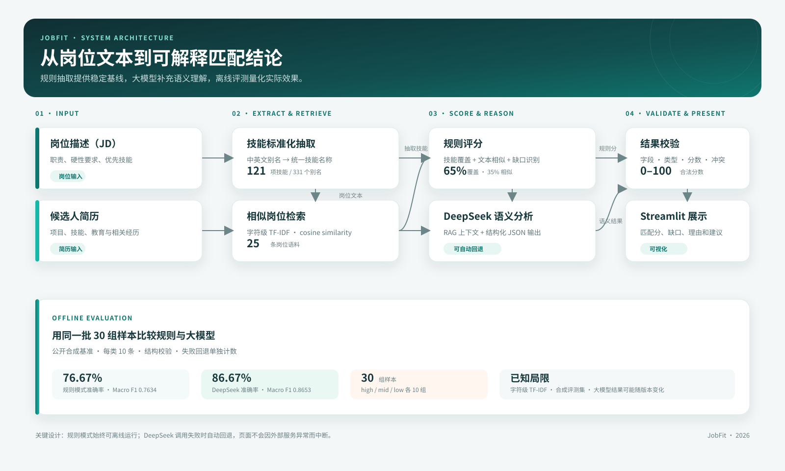

# JobFit · AI 岗位匹配与技能缺口分析助手

> 粘贴一份 JD 和一份简历，输出匹配分、已匹配技能、缺口技能与可执行的改进建议。

一个面向 **AI 应用开发 / 数据分析实习岗位** 的小型 RAG + LLM 应用：
规则负责可解释的技能匹配，大模型负责语义判断与建议生成，评测脚本负责量化效果。



## 功能

- **技能抽取**：内置 100+ 技能词典（中英文别名），从 JD 与简历中抽取标准化技能
- **岗位检索**：TF-IDF 在岗位库中检索相似 JD，作为大模型判断的上下文（最小 RAG 实现）
- **匹配打分**：技能覆盖率与文本相似度加权计算，权重集中在 `core/scorer.py` 配置，可解释、可复现
- **大模型增强**：接入任意 OpenAI 兼容接口（DeepSeek / 通义 / Kimi / OpenAI），输出结构化 JSON
- **可视化**：Streamlit 页面 + 雷达图 + 缺口技能列表
- **可评测**：公开 30 组合成标注基准，支持规则/大模型对比、混淆矩阵和分类指标

## 架构



输入 JD 与简历后，系统先完成技能标准化和相似岗位检索。规则模式直接生成
可解释的覆盖率与相似度分数；启用大模型时，DeepSeek 结合检索上下文输出
结构化判断。所有模型结果都会经过字段与类型校验，失败时自动回退规则模式。

## 快速开始

```powershell
git clone https://github.com/QUYVYV/jobfit.git
cd jobfit
python -m venv .venv
.\.venv\Scripts\Activate.ps1
python -m pip install -r requirements.txt

# 不配置 API Key 也能跑（规则模式）
python -m streamlit run app.py

# 想用大模型增强：复制 .env.example 为 .env 并填入 Key
Copy-Item .env.example .env
# 在 .env 中填写真实 LLM_API_KEY，不要提交该文件
python -m streamlit run app.py
```

项目会在启动时自动加载根目录的 `.env`。大模型调用会强制要求 JSON 结构、
校验分数与字段类型，并在失败时回退到规则模式。连续调用测试：

```bash
python scripts/test_llm.py
```

该脚本会执行 5 次真实 API 请求，请先确认账户余额和费用预期。

## 演示

三分钟演示的分镜、讲稿和录制检查清单见
[docs/demo-script.md](docs/demo-script.md)。

## 评测

仓库包含 `eval/benchmark.csv`：30 组脱敏合成样本，`high / mid / low`
各 10 组；领域分布为 AI 应用 11 组、数据分析 10 组、测试开发 9 组，
可用于复现 README 中的指标。

规则模式不产生 API 费用：

```bash
python eval/evaluate.py --labels eval/benchmark.csv --mode rule
```

大模型模式会执行 30 次 API 请求：

```bash
python eval/evaluate.py --labels eval/benchmark.csv --mode llm
```

也可以在同一次运行中比较两种模式：

```bash
python eval/evaluate.py --labels eval/benchmark.csv --mode compare
```

### 实际结果（2026-11-08）

| 模式 | 准确率 | Macro F1 |
|---|---:|---:|
| 规则模式 | 76.67%（23/30） | 0.7634 |
| DeepSeek `deepseek-chat` | 86.67%（26/30） | 0.8653 |

| 模式 | 类别 | Precision | Recall | F1 |
|---|---|---:|---:|---:|
| 规则 | high | 0.6667 | 1.0000 | 0.8000 |
| 规则 | mid | 0.7500 | 0.6000 | 0.6667 |
| 规则 | low | 1.0000 | 0.7000 | 0.8235 |
| 大模型 | high | 1.0000 | 1.0000 | 1.0000 |
| 大模型 | mid | 0.8750 | 0.7000 | 0.7778 |
| 大模型 | low | 0.7500 | 0.9000 | 0.8182 |

规则模式混淆矩阵：

```
混淆矩阵（行=人工标签，列=模型预测）：
           high     mid     low
  high        10       0       0
   mid         4       6       0
   low         1       2       7
```

大模型模式混淆矩阵：

```
混淆矩阵（行=人工标签，列=模型预测）：
           high     mid     low
  high        10       0       0
   mid         0       7       3
   low         0       1       9
```

规则模式倾向把部分 `mid` 判成 `high`，大模型减少了这类高估，
但仍会把部分 `mid` 判成 `low`。本次大模型调用没有发生失败或规则回退。

大模型结果来自同一模型的一次完整运行，可能随模型版本和采样变化；
规则结果可完全离线复现。

### 个人评测集

如需评测自己的样本：

1. 复制 `eval/labels_template.csv` 为 `eval/labels.csv`。
2. 填入 JD、脱敏简历和 `high/mid/low` 标签。
3. 运行 `python eval/evaluate.py --labels eval/labels.csv`。

> `labels.csv` 可能包含个人简历信息，已在 `.gitignore` 中排除；如需公开，请先脱敏。
> `.env` 同样已被 Git 排除，API Key 不应写入代码、截图或公开笔记。

## 目录结构

```
jobfit/
├── app.py                  # Streamlit 入口
├── core/
│   ├── skills.py           # 技能词典抽取
│   ├── retrieval.py        # TF-IDF 相似岗位检索
│   ├── scorer.py           # 规则打分 / LLM 打分
│   └── llm.py              # OpenAI 兼容接口调用
├── data/
│   ├── skills.json         # 技能词典（可自行扩充）
│   └── jds.jsonl           # 岗位库（可自行扩充）
├── eval/
│   ├── evaluate.py         # 评测脚本
│   ├── benchmark.csv       # 30 组公开合成标注基准
│   └── labels_template.csv # 个人标注模板
├── docs/
│   ├── architecture.svg    # 系统架构图
│   ├── demo-script.md      # 三分钟演示脚本
│   └── screenshot.png      # 完整界面截图
├── requirements.txt
└── .env.example
```

## 我的收获

- 理解了 **规则 + 大模型的分工**：规则保证下限与可解释性，大模型补语义与表达
- 走通了 **RAG 的最小闭环**：检索 → 拼上下文 → 结构化生成 → 评测
- 用 **混淆矩阵** 定位错误类型，而不是只看一个准确率
- 体会到 **Prompt 的结构化约束**（要求 JSON、失败重试）对工程稳定性的影响

## Roadmap

已完成：

- [x] 技能标准化抽取与 121 项中英文技能词典
- [x] 25 条岗位语料与相似岗位检索
- [x] 规则评分、DeepSeek 语义增强和失败回退
- [x] 模型输出 JSON 结构与字段校验
- [x] 30 组公开评测基准与双模式指标
- [x] Streamlit 页面、示例填充和完整界面截图

下一步：

- [ ] 支持 PDF 简历上传与自动解析
- [ ] 接入向量 Embedding 检索，对比 TF-IDF 召回差异
- [ ] 扩充岗位库到 200 条，并按岗位类型分桶评测
- [ ] 增加「简历改写建议」的一键生成
- [ ] 引入更多真实脱敏样本，验证合成基准之外的泛化效果

## 已知局限

- 当前检索是字符级 TF-IDF，不是真正的语义向量检索。
- 30 组评测样本为合成数据，不能完全代表真实招聘分布。
- DeepSeek 结果可能随模型版本和采样变化，README 指标注明了一次运行日期。
- 简历目前以纯文本粘贴为主，尚无 PDF 解析和数据持久化。

## 说明

本项目为个人学习与实践项目，用于演示 AI 应用开发中的「技能抽取 + 检索 + 大模型 + 评测」链路，
不构成任何招聘建议。原有演示 JD 与示例简历为虚构数据；新增岗位语料来自公开招聘页面，
仅保留检索所需的职责摘要并记录来源，岗位信息可能随时间变化。
